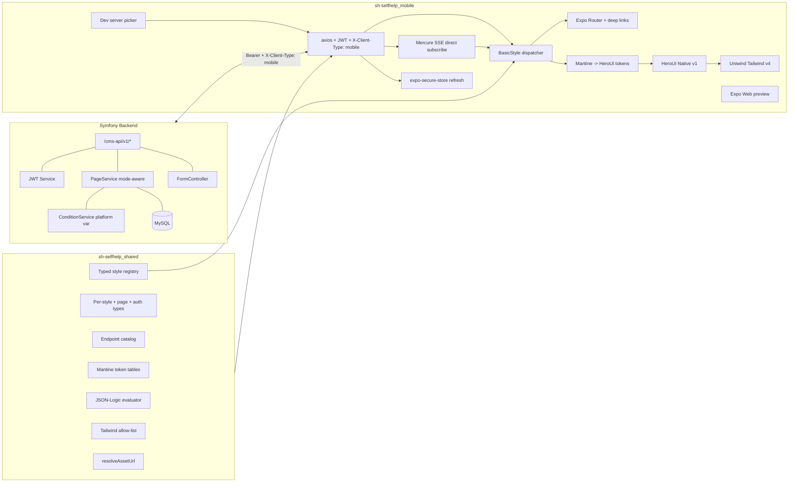
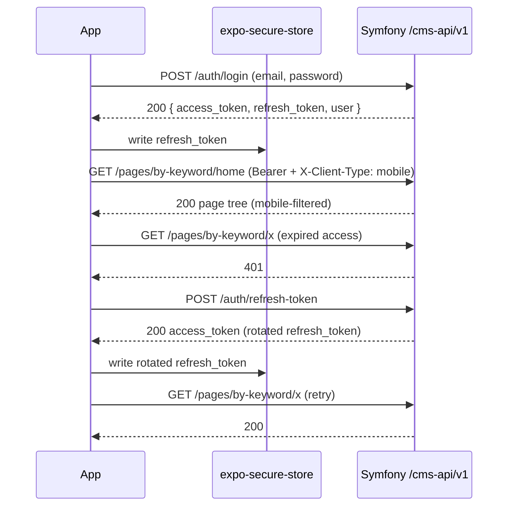

/*
SPDX-FileCopyrightText: 2026 Humdek, University of Bern
SPDX-License-Identifier: MPL-2.0
*/
# Architecture

Audience: Developers and technical operators.
Status: active.
Applies to: SelfHelp2 mobile app (sh-selfhelp_mobile).
Last verified: 2026-11-13.
Source of truth: Runtime code, configuration, and tests in this repository.

How the mobile app, backend, and shared package fit together.

## High-level diagram

## Request flow

## Layers

1. **Providers** (`providers/`) — `ErrorBoundary`, `ServerProvider`, `QueryProvider`, `I18nProvider`, `ThemeProvider`, `AuthProvider`, `SessionSyncProvider`, `NativeBootstrap`. Composed by `AppProviders.tsx`. They run in this order so that auth restore waits for the configured base URL before any protected page/menu work is enabled.
2. **Stores** (`stores/`) — Zustand: `serverStore` (URL), `authStore` (access token + user), `languageStore` (locale + available languages).
3. **Services** (`services/`) — typed wrappers around the API: `apiClient.ts` (singleton axios), `pageService.ts`, `formsService.ts`, `authService.ts`, `languageService.ts`, `secureStore.ts`.
4. **Hooks** (`hooks/`) — TanStack Query wrappers: `usePageContent`, `useLanguages`, `useFormSubmit`.
5. **Renderer** (`components/renderer/`) — `PageRenderer` walks the page tree, runs `{{field}}` interpolation, and dispatches each section to a registered style component via `BasicStyle`. It never evaluates a `condition`: the backend already removed the sections that fail it. `UnknownStyle` and `DebugWrapper` give safe fallbacks.
6. **Styles** (`components/styles/`) — One folder per CMS style group (layout, typography, media, interactive, forms, composite, auth). The map from `style_name → React component` lives in `components/styles/index.ts`.
7. **Native** (`native/`) — Expo modules: notifications, deep links, permissions, audio recorder, OTA updates, device service.

## Page rendering pipeline

The backend decides which sections a user sees: `ConditionService` removes a section whose `condition` fails for the signed-in user before it builds the payload. The app does not evaluate a condition again — the device would use other inputs (no user groups, its own clock, a locale string) and could hide what the server chose to show. With `debug=1` the backend keeps a failed section and adds `condition_debug`, which `DebugWrapper` shows.

For every section in the tree:

1. **Interpolation** — every `{{field}}` placeholder is resolved via `replaceCalcedValues` against the page's value map.
2. **Class string** — `buildSectionClasses(section)` parses `css_mobile`, runs each token through the shared allow-list + remap, and joins the survivors. Unsupported tokens are dropped + warned in `__DEV__`.
3. **Theme props** — the unprefixed portable semantic fields (`size`, `color`, `radius`, `spacing`, `variant`) are mapped to HeroUI props by the helpers in `styles/`.
4. **Render** — the registered HeroUI Native impl receives `{ section, values }`. Children (when present) are recursively rendered through `<Children>`.

## State + cache

- TanStack Query with `createAsyncStoragePersister` persists page caches across cold starts. Query keys include server URL and auth scope so anonymous/stale data cannot satisfy logged-in menu/page requests after a reload.
- Everything cached for the user is emptied together on logout, server switch and a rejected refresh (`clearAuthSession({ clearQueries: true })` → `services/clientCaches.ts`): the query cache (memory and persisted) **and** the `expo-image` disk and memory caches, which hold downloaded restricted assets. Image, video and audio requests carry the bearer token through `useAssetSource`; see [auth-bootstrap.md](./auth-bootstrap.md).
- **Entry lists** (`entry-form-list`, `data-view`, in `components/styles/composite/FormList/`) read `GET /lists/{section_id}/state` with the list's own `<key>.*` query. The rows are the records of one person at one moment, so their query roots (`form-list`, `form-list-history`; `services/formListQueryKeys.ts`) are never written to storage, carry the server, account, language and page in their key, are removed on logout, server switch and a rejected refresh, and are read again when the groups of the person change. A refusal (sign-in expired, access revoked) hides cached rows; another failed refresh keeps them with a notice. The state of a list (page, search, sort, filters, open record) lives in the screen and is set by the route or deep-link parameters of its key (`RouteParamsContext`), not by a navigation entry per keystroke. A `data-view` with the `custom` layout carries the record layout the server already filled with each record's values (`rows[].sections`); `FormListTemplateRows` draws those sections with `BasicStyle` and `listDrawing()` (`FormList.logic.ts`) picks table, cards or template, so the phone never resolves record tokens itself. The server also decides, record by record, which of those sections a record has (a section can depend on the record's own values, on the visitor and on the page's route parameters): `rowTemplateSections(row)` hands over exactly the sections the row carries, and the phone never reads or evaluates a condition (`__tests__/fixtures/form-list-row-conditions.json` is the fixture the backend, the web renderer and the app share). The page's declared route parameters (`page.route_params`, handed down as `values.page_route_params`) travel with the list read (`route[name]=value`) and are part of the cache key, because a record template can read `{{route.record_id}}`; the last part of every list key says whether the draft of the page (`preview`) or the published page was read, so rows of the other version never stand in while a list loads. Every write (save, delete, quick action, restore) and every history read carries `preview` when the person looks at the draft (`hooks/useWritePreview.ts`, the same policy as the page read) and names the version of the record it acts on. A file of an earlier version is read with the session (`GET /lists/{section}/records/{record}/versions/{version}/files/{field}`, access = history access), kept in the app cache and opened with the system share sheet (`services/formListFileDownload.ts`; `expo-file-system` and `expo-sharing`); the cache folder is emptied with the other client caches on logout and server switch.
- Auth state is in-memory (`accessToken`) + SecureStore (`refresh_token`) so a phone reboot doesn't kick the user out, but a memory dump can't reveal the access token. See [auth-bootstrap.md](./auth-bootstrap.md) for the exact restore order, refresh queue, direct reload behavior, and live-update fallback.
- `SessionSyncProvider` holds the authenticated `user-data` query, watches `acl_version`, and subscribes directly to Mercure via `hooks/useAclEventStream.ts`. On Expo Web this is still a direct hub connection, not a same-origin BFF proxy; the browser host therefore must be allow-listed in both Symfony API CORS and the Mercure hub `cors_origins`.

## Related docs

- [setup.md](../operations/setup.md) — install + first run.
- [server-selection.md](../operations/server-selection.md) — multi-tenant strategy.
- [styling/cms-classes.md](./styling/cms-classes.md) — CMS Tailwind allow-list + remap.
- [cookbook/add-style.md](../cookbook/add-style.md) — extending the renderer.
